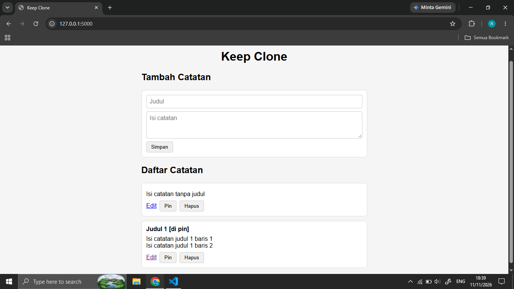
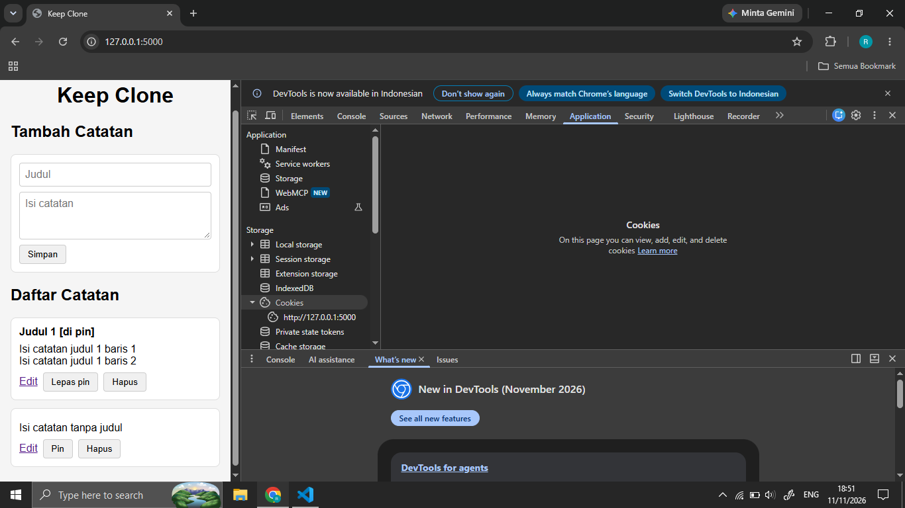

# Keep Clone

Aplikasi catatan sederhana yang terinspirasi Google Keep, dibuat dengan Python dan Flask sebagai proyek belajar.

## Fitur

- Menambah, melihat, mengubah, dan menghapus catatan
- Judul opsional, isi catatan wajib
- Pin catatan agar tampil paling atas
- Tampilan responsif (nyaman di HP)
- Validasi di browser dan di server

## Teknologi

| Teknologi      | Peran                       |
| -------------- | --------------------------- |
| Python + Flask | Logika aplikasi dan routing |
| SQLite         | Penyimpanan data            |
| Jinja2         | Template HTML dinamis       |
| HTML + CSS     | Struktur dan tampilan       |

## Cara Menjalankan

1. Clone repository ini
2. Buat dan aktifkan virtual environment:
   `python -m venv venv` lalu `venv\Scripts\activate` (Windows)
3. Install dependensi: `pip install -r requirements.txt`
4. Jalankan: `flask --app app run --debug`
5. Buka `http://127.0.0.1:5000`

## Screenshot

### Halaman utama

### Halaman utama (responsif)

## Yang Saya Pelajari

- Logika aplikasi dan routing menggunakan Python dengan Flask
- Penggunaan SQLite sebagai opsi database tanpa server yang ramah bagi pemula
- Logika pin, serta tampilan kartu pada aplikasi menggunakan CSS
- Layar responsif perangkat yang ternyata penerapannya ramah bagi pemula

## Keterbatasan dan Rencana Pengembangan

- Belum ada login, jadi semua catatan bisa dilihat siapa pun yang mengakses aplikasi
- Belum di-deploy. Rencana deploy ke layanan hosting dengan database yang persisten
- Fitur yang belum ada: [warna, arsip, checklist, pencarian, label]
